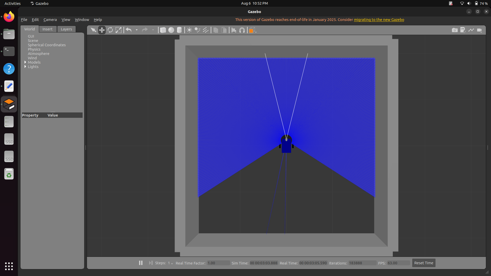
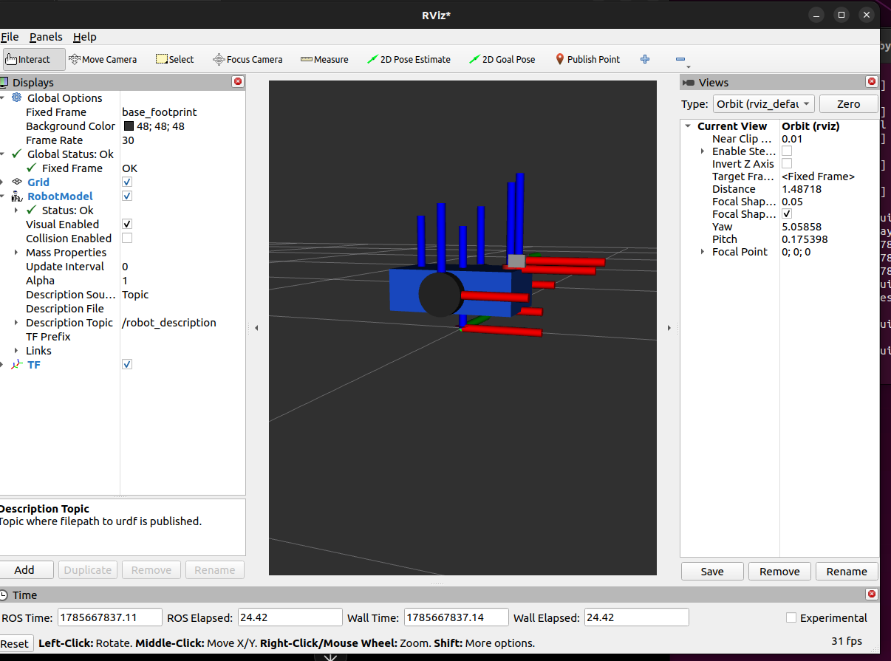
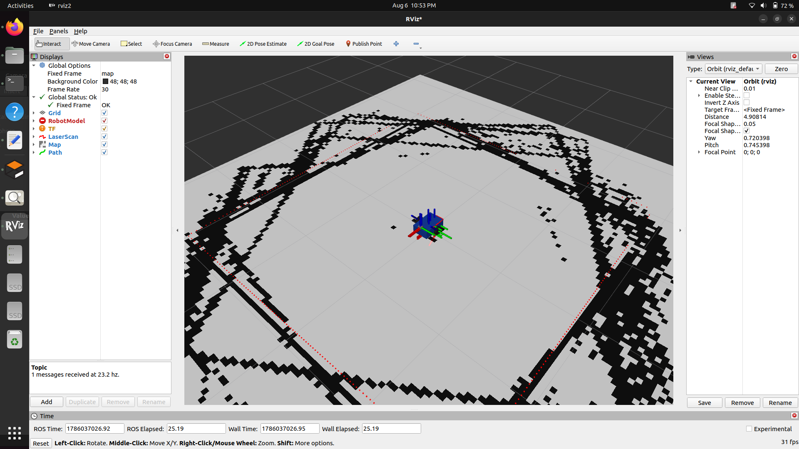
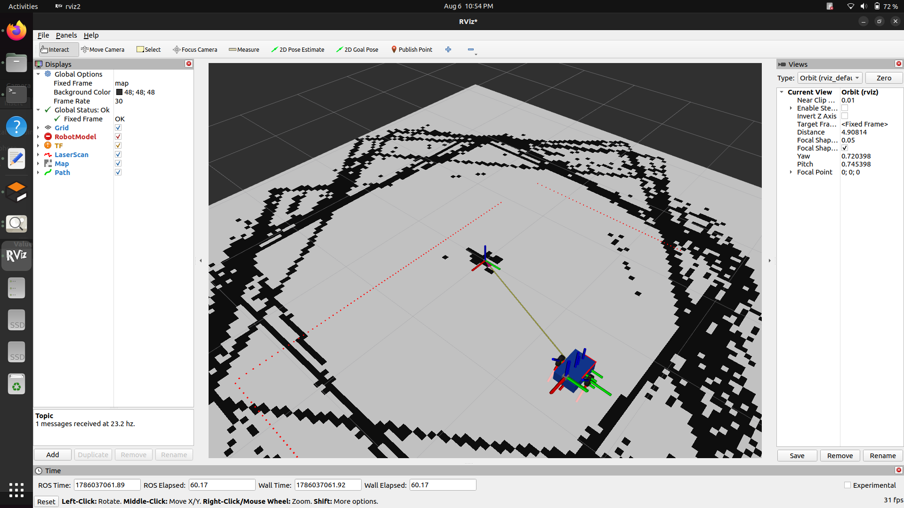
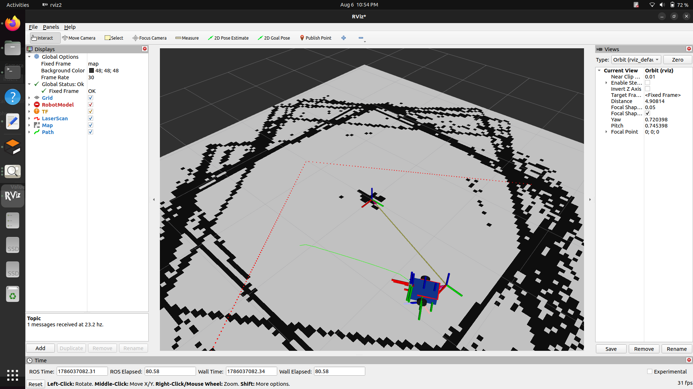
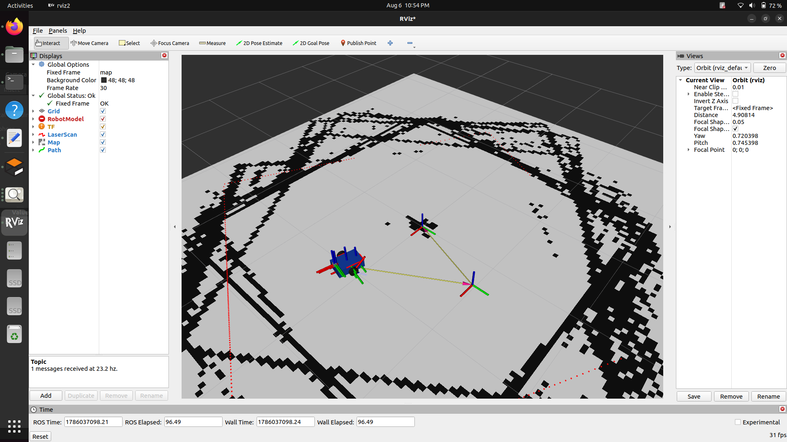

<div align="center">

# 🤖 ROS2 Differential Drive Robot

**A complete differential drive mobile robot simulation, from URDF modeling to SLAM mapping and autonomous navigation.**


</div>

---

## 📑 Table of Contents

- [Overview](#-overview)
- [Features](#-features)
- [Demo](#-demo)
- [Tech Stack](#-tech-stack)
- [Robot Description](#-robot-description)
- [Project Structure](#-project-structure)
- [Getting Started](#-getting-started)
- [Usage](#-usage)
- [Screenshots](#-screenshots)
- [TF Tree](#-tf-tree)
- [Results](#-results)
- [Future Improvements](#-future-improvements)
- [Acknowledgements](#-acknowledgements)
- [Author](#-author)
- [License](#-license)

---

## 📌 Overview

This project demonstrates the full workflow of building a mobile robot in ROS2: modeling the robot, simulating it in Gazebo, mapping an environment with **SLAM Toolbox**, and navigating autonomously to user-defined goals on the saved map using **Navigation2 (Nav2)**.

**Pipeline:**

```text
Robot Modeling (Xacro) → Gazebo Simulation → SLAM Mapping → Save Map → AMCL Localization → Nav2 Autonomous Navigation
```

---

## ✨ Features

| Category | Details |
|---|---|
| **Robot** | Differential drive base with caster wheel, modular Xacro design |
| **Sensors** | 360° LiDAR, RGB camera, IMU |
| **Control** | `ros2_control` integration |
| **Mapping** | SLAM Toolbox, occupancy grid map generation |
| **Navigation** | AMCL localization, global and local planning, costmaps, obstacle avoidance |
| **Visualization** | RViz2 configs for the robot and navigation |

---

## 🎥 Demo

Full project demonstration (SLAM mapping and autonomous navigation):

https://github.com/user-attachments/assets/9da91be3-03ba-4e29-a5b2-dbb39ce00456

---

## 🛠 Tech Stack

| Component | Version / Tool |
|---|---|
| OS | Ubuntu 22.04 |
| ROS | ROS2 Humble |
| Simulator | Gazebo 11 |
| Visualization | RViz2 |
| Navigation | Navigation2 (Nav2), AMCL |
| Mapping | SLAM Toolbox |
| Robot Description | URDF / Xacro |
| Control | ros2_control |
| Languages | Python (launch files), C++ |

---

## 🤖 Robot Description

The robot is built from modular Xacro files, so each part can be modified independently.

**Links and components:** base footprint, base link, left wheel, right wheel, caster wheel, LiDAR, RGB camera, IMU.

### Sensors

| Sensor | Output |
|---|---|
| **LiDAR** | 360° laser scan published on `/scan` |
| **Camera** | RGB image topics |
| **IMU** | Orientation, angular velocity, linear acceleration |

---

## 📂 Project Structure

```text
diff_drive_robot/
├── config/
│   ├── controllers.yaml        # ros2_control controller setup
│   ├── nav2_params.yaml        # Nav2 parameters
│   └── slam.yaml               # SLAM Toolbox parameters
├── launch/
│   ├── display.launch.py       # Robot model in RViz
│   ├── gazebo.launch.py        # Gazebo simulation
│   ├── slam.launch.py          # SLAM mapping
│   ├── navigation.launch.py    # Navigation stack
│   └── nav2.launch.py          # Nav2 bringup
├── maps/
│   ├── my_map.pgm
│   └── my_map.yaml
├── rviz/
│   ├── diff_drive_robot.rviz
│   └── navigation.rviz
├── urdf/
│   ├── robot.xacro             # Main entry file
│   ├── base.xacro
│   ├── wheels.xacro
│   ├── caster.xacro
│   ├── laser.xacro
│   ├── camera.xacro
│   ├── imu.xacro
│   ├── ros2_control.xacro
│   ├── gazebo.xacro
│   ├── materials.xacro
│   └── inertia_macros.xacro
├── worlds/
│   └── my_world.world
├── images/
├── package.xml
├── CMakeLists.txt
├── LICENSE
└── README.md
```

---

## 🚀 Getting Started

### Prerequisites

- Ubuntu 22.04
- ROS2 Humble
- Gazebo 11

Install the required packages:

```bash
sudo apt update
sudo apt install -y \
  ros-humble-gazebo-ros-pkgs \
  ros-humble-ros2-control \
  ros-humble-ros2-controllers \
  ros-humble-gazebo-ros2-control \
  ros-humble-navigation2 \
  ros-humble-nav2-bringup \
  ros-humble-slam-toolbox \
  ros-humble-xacro \
  ros-humble-rviz2
```

### Build

```bash
cd ~/ros2_projects_ws/src
git clone https://github.com/prachikale05/diff_drive_robot.git

cd ~/ros2_projects_ws
colcon build --symlink-install
source install/setup.bash
```

---

## ▶️ Usage

Open a new terminal for each step and source the workspace first (`source ~/ros2_projects_ws/install/setup.bash`).

### 1. Launch the Gazebo simulation

```bash
ros2 launch diff_drive_robot gazebo.launch.py
```

### 2. Build a map with SLAM

```bash
ros2 launch diff_drive_robot slam.launch.py
```

Drive the robot around the environment, then save the map:

```bash
ros2 run nav2_map_server map_saver_cli -f ~/ros2_projects_ws/src/diff_drive_robot/maps/my_map
```

### 3. Navigate autonomously

```bash
ros2 launch diff_drive_robot navigation.launch.py
```

In RViz2, load `rviz/navigation.rviz`, set the initial pose with **2D Pose Estimate**, then send a goal with **Nav2 Goal**.

---

## 📸 Screenshots

| Gazebo Simulation | Robot in RViz |
|:---:|:---:|
|  |  |

| SLAM Mapping | Saved Map |
|:---:|:---:|
|  |  |

| Nav2 Goal | Goal Reached |
|:---:|:---:|
|  |  |

---

## 🌳 TF Tree

The TF tree was generated with `tf2_tools`. See the full diagram here: [`images/tf_tree.pdf`](images/tf_tree.pdf)

---

## ✅ Results

- [x] Robot simulation in Gazebo
- [x] Differential drive motion
- [x] LiDAR scanning, camera visualization, and IMU data publishing
- [x] SLAM mapping and occupancy grid map generation
- [x] AMCL localization
- [x] Goal-based path planning and execution with Nav2

---

## 🔮 Future Improvements

- [ ] Dynamic obstacle avoidance
- [ ] Waypoint navigation
- [ ] Camera-based object detection
- [ ] Autonomous exploration
- [ ] Multi-robot simulation
- [ ] Real robot deployment
- [ ] Path optimization

---

## 🙏 Acknowledgements

Built with [ROS2 Humble](https://docs.ros.org/en/humble/), [Gazebo](https://classic.gazebosim.org/), [Navigation2](https://navigation.ros.org/), [SLAM Toolbox](https://github.com/SteveMacenski/slam_toolbox), RViz2, and ros2_control.

---

## 👩‍💻 Author

**Prachi Kale**
B.Tech, Robotics & Automation Engineering
K. K. Wagh Institute of Engineering Education and Research

GitHub: [@prachikale05](https://github.com/prachikale05)

---

## 📜 License

This project is licensed under the **MIT License**. See [LICENSE](LICENSE) for details.
